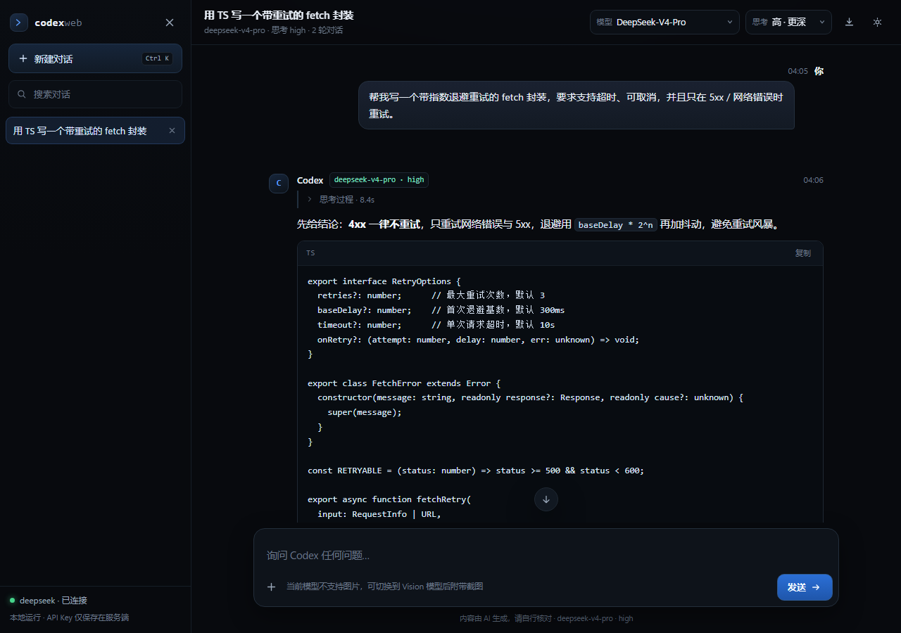

# Codex Web · 浏览器对话端

[](LICENSE)
[](https://nodejs.org/)
[](https://github.com/demonnicelzb/codex-config-webui/releases/latest)

给 Codex CLI 的模型供应商配一个网页对话界面：直接复用 `~/.codex/config.toml` 里的 provider、API Key 与
`models.json` 模型目录，所以在浏览器里看到的模型（DeepSeek-V4-Pro / Flash / Vision）和思考强度与终端里的
`codex` 完全一致。

零依赖：只用 Node.js 内置模块，没有 `npm install`，没有构建步骤，不引入任何 CDN 资源（离线可用）。



## 直接下载使用（不用 Git、不用装依赖）

只想用、不想看代码：去 [**Releases**](https://github.com/demonnicelzb/codex-config-webui/releases/latest)
下载 `codex-web-v1.0.0.zip`，解压后双击 `启动.cmd`（Windows）或执行 `node server.mjs`（macOS / Linux）。

前提只有三条：Node.js 18+、能访问模型 API、本机已有一份 Codex 配置（`~/.codex/config.toml` 与
`models.json`）。API Key 不会随包分发，所以换机器时要自己准备配置或用环境变量。

## 快速开始

```bash
cd codex-web
node server.mjs          # 或：npm start / 双击「启动.cmd」
```

启动后终端会打印地址（默认 <http://127.0.0.1:8788>）并自动打开浏览器。按 `Ctrl+C` 停止。

常用参数：

| 参数 | 说明 |
| --- | --- |
| `--port 9000` | 指定端口（默认 8788；被占用时会自动往后找可用端口） |
| `--host 0.0.0.0` | 允许局域网访问（**注意**：此时同网段的人都能用你的 API Key） |
| `--no-open` | 不自动打开浏览器 |

要求：Node.js 18+（本机实测 v24），以及对 `api.deepseek.com` 的正常网络访问。

## 功能

- **流式回答 + 独立思考面板**：`reasoning` 增量实时显示「思考过程 · 3.2s」，回答开始后自动收起，可随时展开。
- **模型与思考强度切换**：模型列表来自 Codex 的 `models.json`；`低 / 高 / 最深` 对应 `low / high / max`。
- **图片理解**：粘贴、拖拽或选择截图，自动切到支持图片的 Vision 模型后随消息发送（`input_image`）。
- **多轮对话与本地历史**：会话存在浏览器 `localStorage`，可搜索、切换、删除；刷新不丢。
- **停止 / 重新生成 / 编辑重发**：`Esc` 或「停止」中断生成（服务端会同时中断上游请求），保留已生成内容。
- **Markdown 渲染**：代码块（带语言标签与一键复制）、表格、引用、列表、行内代码、链接；渲染前统一转义，防 XSS。
- **用量与耗时**：每条回答底部显示 `in / out / think` token 与耗时。
- **导出 Markdown**：顶栏下载按钮导出当前会话（含折叠的思考过程）。
- **纯本地安全模型**：服务只监听 `127.0.0.1`；API Key 只在服务端使用，浏览器只收到规范化后的 SSE。

## 配置从哪里来

服务端启动时（以及每次对话请求时）读取：

```
~/.codex/config.toml          → model / model_provider / model_reasoning_effort
                                [model_providers.<id>] 的 base_url、wire_api
                                experimental_bearer_token（或 env_key 环境变量）
~/.codex/models.json          → 模型目录（model_catalog_json 指向的文件）
```

API Key 的解析顺序：`experimental_bearer_token` → `~/.codex/auth.json` → 环境变量
（`<PROVIDER>_API_KEY` / `OPENAI_API_KEY` / `DEEPSEEK_API_KEY`）。

请求发往 `base_url + /responses`（`wire_api = "responses"` 时），若上游返回 404/405 会自动回退尝试
`base_url + /v1/responses`；`wire_api = "chat"` 时改走 `/chat/completions` 并解析 `delta.content` /
`delta.reasoning_content`。修改 `config.toml` 后**无需重启**服务。

当 `base_url` 中没有 `/v1` 段时（例如本机配置的 `https://api.deepseek.com/`），两种路径都已验证可用。

## 快捷键

| 按键 | 作用 |
| --- | --- |
| `Enter` | 发送 |
| `Shift + Enter` | 换行 |
| `Esc` | 停止生成 |
| `Ctrl/Cmd + K` | 新建对话 |
| 拖拽 / `Ctrl + V` | 添加图片（最多 4 张，单张 ≤ 6MB） |

## 目录结构

```
codex-web/
├─ server.mjs              # HTTP 服务：静态资源 + /api/bootstrap + /api/chat(SSE) + /api/health
├─ lib/codex-config.mjs    # 极简 TOML 解析、provider/Key/模型目录解析
├─ public/
│  ├─ index.html           # 页面骨架
│  ├─ styles.css           # 暗色主题 / 响应式布局
│  ├─ app.js               # 状态、流式渲染、会话存储、交互
│  └─ markdown.js          # 手写 Markdown 渲染器（流式容错）
├─ test/
│  ├─ smoke.mjs            # 启动 + 真实流式对话冒烟测试
│  ├─ api-edge.mjs         # 错误模型、图片、文本模型拒绝图片、客户端中断
│  ├─ ui-shot.mjs          # 用 CDP 驱动真实页面打字→流式回答→截图
│  └─ ui-flows.mjs         # 停止 / 重新生成 / 多轮 / 刷新持久化
├─ docs/preview.png
└─ 启动.cmd                # Windows 双击启动
```

## 测试

服务运行后（另开一个窗口）：

```bash
node test/smoke.mjs 8788       # 后端：配置解析 + 真实流式作答
node test/api-edge.mjs 8788    # 边界：错误信息、图片、中断
```

UI 测试需要一个无头 Edge/Chrome（脚本通过 CDP 操作真实页面）：

```powershell
$profile = Join-Path $env:TEMP "codexweb-test"
& "C:\Program Files (x86)\Microsoft\Edge\Application\msedge.exe" --headless=new --disable-gpu `
  --remote-debugging-port=9333 --remote-allow-origins=* --user-data-dir="$profile" about:blank
# 另一个窗口：
node test/ui-shot.mjs http://127.0.0.1:8788/ .shots/live.png 9333
node test/ui-flows.mjs http://127.0.0.1:8788/ 9333
```

## 常见问题

**端口被占用？** 会自动从 8788 往后找第一个可用端口，看启动日志里的实际地址即可。

**对话报 400「The supported API model names are ...」** 说明 `config.toml` 里的 `model` 不被该 provider
支持。用下拉框换成模型列表里的其他模型，或在 `config.toml` 里改 `model`。

**图片发不出去？** 当前模型（`deepseek-v4-pro`）只支持文本。附加图片时界面会自动切到
`deepseek-v4-flash-vision-exp`；也可以手动切换。

**界面打不开 / 一直显示「服务端未连接」** 先确认 `node server.mjs` 的窗口没关，再访问终端里打印的地址；
若改过端口，注意地址也要跟着改。

**想清空历史？** 浏览器 DevTools → Application → Local Storage 删除 `codexweb.v1`。

**它和 `codex` CLI 是什么关系？** 共用同一份 provider / Key / 模型配置，但这是一个**纯对话**界面：
它不会在你的工作区读写文件、执行命令或运行测试。需要这些能力时仍然用终端里的 `codex`；
如果想把 agent 能力也搬到浏览器（`codex exec --json` 桥接 + 工具调用审批），可以在此基础上加一层。

## 安全说明

- 默认只监听 `127.0.0.1`，不要在没有反代鉴权的情况下改成 `0.0.0.0` 暴露到公网。
- 浏览器端从未接触过 API Key；请求体只包含对话内容与图片。
- 会话记录保存在浏览器本地；导出 Markdown 时请注意其中可能包含敏感信息。
